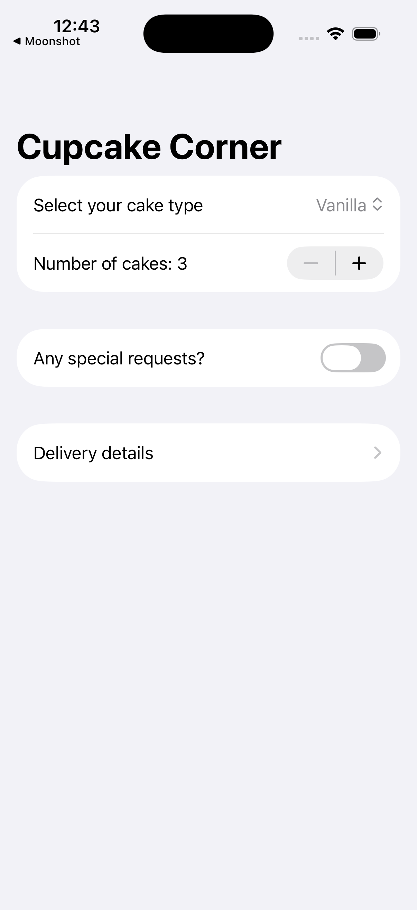
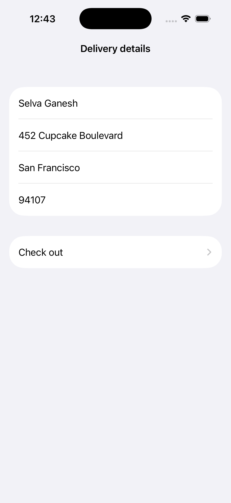
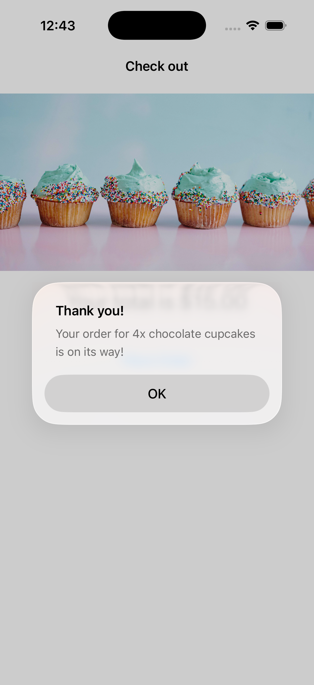

# Cupcake Corner 🧁

A delightful multi-screen cupcake ordering and checkout application for iOS built with **SwiftUI**, developed as part of Paul Hudson's *100 Days of SwiftUI* (Project 10 & Wrap-Up Challenges).

Cupcake Corner lets users customize their cupcake order (flavor, quantity, special frosting, and sprinkles), enter and persist delivery information, calculate real-time totals, and securely submit orders to a remote server using asynchronous networking (`URLSession`).

---

## 📱 App Previews

<p align="center">
  
  &nbsp;&nbsp;
  
  &nbsp;&nbsp;
  
  &nbsp;&nbsp;
  
</p>

---

## ✨ Features

- **Custom Order Configuration**: Choose from multiple cupcake varieties (Vanilla, Strawberry, Chocolate, Rainbow) and select quantities using a responsive `Stepper`.
- **Special Requests & Dynamic Dependencies**: Optional toggles for extra frosting and sprinkles that reset automatically if special requests are disabled.
- **Strict Address Validation (Challenge 1)**: Verifies that shipping details (Name, Street Address, City, Zip) are filled and rejects entries consisting solely of empty spaces / whitespace.
- **Address Persistence (Challenge 3)**: Automatically remembers the user's delivery address across app launches via `UserDefaults` with property observers (`didSet`).
- **Real-Time Cost Computation**: Live calculation of the total price taking into account base cake rates, flavor tiers, and optional add-ons.
- **Remote Asynchronous Checkout**: Encodes orders into JSON via `Codable` and uploads them to a remote REST endpoint using modern Swift concurrency (`async`/`await` with `URLSession`).
- **Informative Network Alerts (Challenge 2)**: Provides user-friendly alerts for both successful orders and network/server failures rather than failing silently.

---

## 🛠 Tech Stack & Key Concepts

- **Language:** Swift 5.9+
- **Framework:** SwiftUI
- **Architecture & Concurrency:**
  - `@Observable` macro for modern reactive state management
  - Modern `async` / `await` and `Task` with `URLSession.shared.upload`
  - Explicit `CodingKeys` to bridge `@Observable` property synthesis with `Codable`
  - Form validation with `.disabled()` modifiers
  - Remote image loading with `AsyncImage` and placeholder progress states
  - Local data persistence with `UserDefaults`

---

## 🚀 Getting Started

### Prerequisites

- macOS Sonoma or later
- Xcode 15.0 or later
- iOS 17.0+ Simulator or physical device

### Installation & Run

1. **Clone the repository:**
   ```bash
   git clone git@github.com:selva7378/CupcakeCorner.git
   cd CupcakeCorner
   ```

2. **Open the project in Xcode:**
   ```bash
   open CupcakeCorner.xcodeproj
   ```

3. **Run the App:**
   - Select your target simulator or connected iOS device in Xcode.
   - Press `Cmd + R` to build and run.

---

## 📂 Project Structure

```text
CupcakeCorner/
├── CupcakeCorner.xcodeproj    # Xcode project configuration
├── CupcakeCorner/             # Swift source files
│   ├── CupcakeCornerApp.swift # Application entry point (@main)
│   ├── ContentView.swift      # Main order selection view (cake types & options)
│   ├── AddressView.swift      # Delivery address input form with validation
│   ├── CheckoutView.swift     # Review total, AsyncImage, and POST checkout
│   ├── Order.swift            # @Observable & Codable model with UserDefaults persistence
│   └── Assets.xcassets        # App icons and color catalog
├── screenshots/               # Application preview screenshots
│   ├── 01_order_view.png
│   ├── 02_address_view.png
│   ├── 03_checkout_view.png
│   └── 04_order_confirmation.png
└── README.md                  # Project documentation
```

---

## 👤 Author

- **Selva Ganesh** - [GitHub](https://github.com/selva7378)
